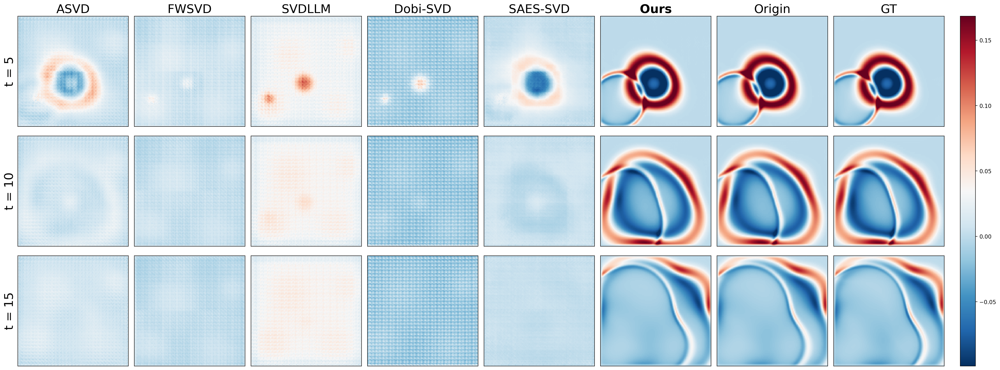

# SAFE-SVD

Official code for the NeurIPS 2026 paper **[“SAFE-SVD: Sensitivity-Aware Fidelity-Enforcing SVD for Physics Foundation Models”](https://arxiv.org/abs/2605.17985)**.

## Quick Result

Rollout comparisons at $t = 5, 10, 15$ between SAFE-SVD (Ours), SVD baselines, the original model (Origin), and ground truth (GT).



## Installation

```
git clone git@github.com:Evave1204/SAFE-SVD-v0.git
cd SAFE-SVD-v0
```

### Environment

```bash
conda create -n safe-svd python=3.11
conda activate safe-svd
python -m pip install -r requirement.txt
```

### Repository

Our experiments use three models: [Poseidon](https://github.com/camlab-ethz/poseidon), [VICON](https://github.com/Eydcao/VICON), and [MPP](https://github.com/PolymathicAI/multiple_physics_pretraining). First, download the Poseidon and MPP source code. Since the latest VICON release differs from the version used in our experiments, we include the experimental version in this repository.

```bash
git clone git@github.com:camlab-ethz/poseidon.git
git clone git@github.com:PolymathicAI/multiple_physics_pretraining.git
```

### Model

Download the original model checkpoints from [Hugging Face](https://huggingface.co/Evave7/SAFE-SVD) using the following script:

```bash
python download/model_download.py
```

### Dataset

Dataset download instructions are provided below. You can also follow the instructions in the [Poseidon](https://github.com/camlab-ethz/poseidon#datasets), [VICON](https://github.com/Eydcao/VICON), and [MPP](https://github.com/PolymathicAI/multiple_physics_pretraining) repositories.

```bash
python download/poseidon_dataset.py
mkdir data/raw_data
cd data
git clone https://github.com/pdebench/PDEBench.git
cd PDEBench/pdebench/data_download
python download_direct.py \
  --root_folder ../../../raw_data \
  --pde_name 2d_cfd \
  --pde_name swe \
  --pde_name 2d_reacdiff \
  --pde_name ns_incom
cd ../../../raw_data
git clone https://huggingface.co/datasets/pdearena/NavierStokes-2D-conditoned
# Data preprocess
cd ../..
python data/prepare/vicon/convert_PDEBench_highVis.py
python data/prepare/vicon/convert_PDEBench_lowVis.py
python data/prepare/vicon/split_PDEBench.py
cp -i safe_svd/configs/mpp_avit_L_config.yaml multiple_physics_pretraining/config/mpp_avit_L_config.yaml
```

## Quick Start

### Compression

#### Poseidon
```bash
python -m safe_svd.main \
  --model poseidon \
  --model_path models/poseidon/fluids.incompressible.PiecewiseConstants \
  --data_path poseidon/camlab-ethz/down_streams \
  --dataset fluids.incompressible.PiecewiseConstants \
  --DEV cuda \
  --rank_ratio 0.2 \
  --rank_selector legacy \
  --traj_num 16 \
  --calibration_seed default \
  --final_time 10 \
  --alpha 0.7 \
  --save_path ./artifacts/poseidon/0.2/
```
#### VICON
```bash
python -m safe_svd.main \
  --model vicon \
  --ckpt_path models/VICON/model.pth \
  --data_root data/processed_data/2D/CFD/converted/ \
  --rank_ratio 0.8 \
  --calibration_num 256 \
  --batch_size 64 \
  --alpha 0.7 \
  --checkpoint_percent 0.1 \
  --save_path ./artifacts/vicon/0.8/
```
#### MPP
```bash
python -m safe_svd.main \
  --model mpp \
  --ckpt_path models/MPP/MPP_AViT_L \
  --yaml_config multiple_physics_pretraining/config/mpp_avit_L_config.yaml \
  --config basic_config \
  --data_root data/raw_data \
  --rank_ratio 0.8 \
  --calibration_num 8 \
  --calibration_seed 42 \
  --batch_size 1 \
  --alpha 0.7 \
  --save_path ./artifacts/mpp/0.8/
```

### Evaluation

#### Poseidon
```bash
python evaluation/poseidon/evaluate.py \
	--poseidon-root ./poseidon \
	--data-root poseidon/camlab-ethz/down_streams \
	--checkpoint models/poseidon/fluids.incompressible.PiecewiseConstants \
	--model artifacts/poseidon/0.2/compressed_model.pt
```

#### VICON
```bash
python evaluation/vicon/evaluate.py \
  --vicon-root ./VICON \
  --data-root data/processed_data/2D/CFD/converted/ \
  --checkpoint models/VICON/model.pth \
  --model artifacts/vicon/0.8/compressed_model.pth \
  --output artifacts/vicon/0.8/metrics.json
```

#### MPP
```bash
python evaluation/mpp/evaluate.py \
  --mpp-root ./multiple_physics_pretraining \
  --data-root data/raw_data \
  --checkpoint models/MPP/MPP_AViT_L \
  --model artifacts/mpp/0.8/compressed_model.pt \
  --output artifacts/mpp/0.8/metrics.json
```

## Citation

If you use this code in your research, please cite our paper:

```bibtex
@inproceedings{hong2026safe,
  author={Hong, Chengjie and He, Feixiang and Zeng, Yiheng and Kang, Lulu and Wang, He},
  title={SAFE-SVD: Sensitivity-Aware Fidelity-Enforcing SVD for Physics Foundation Models},
  booktitle = {Neural Information Processing Systems (NeurIPS)},
  year = {2026}
}
```
